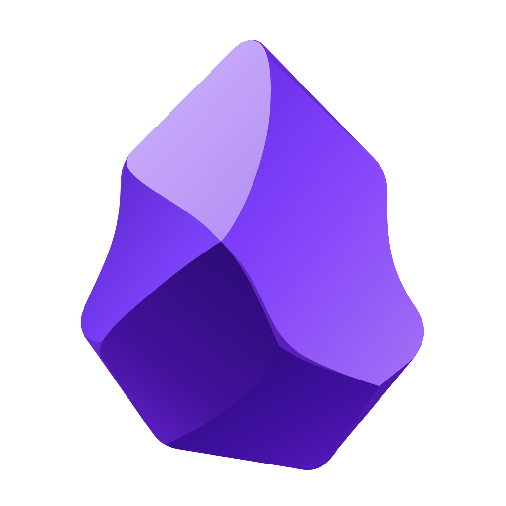
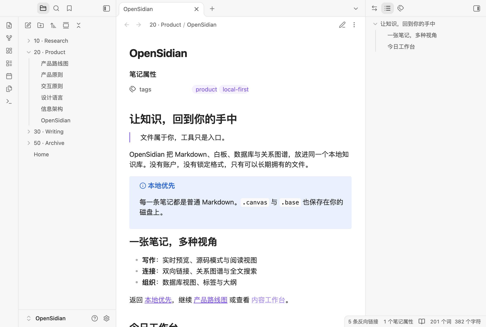
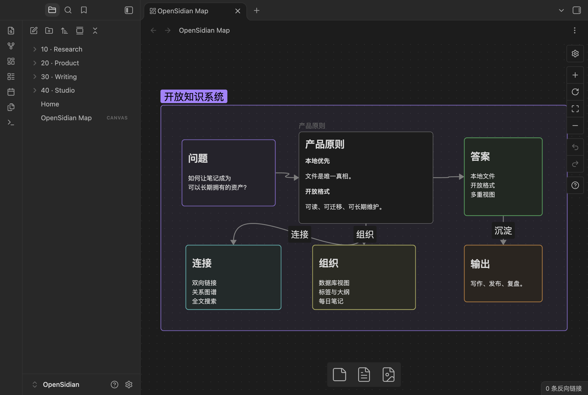
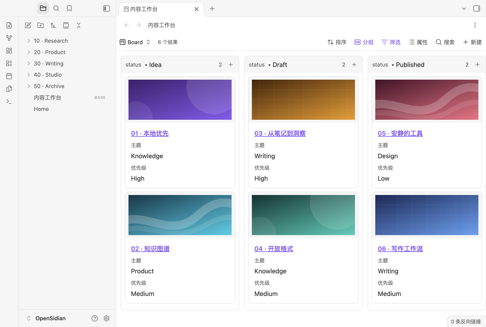
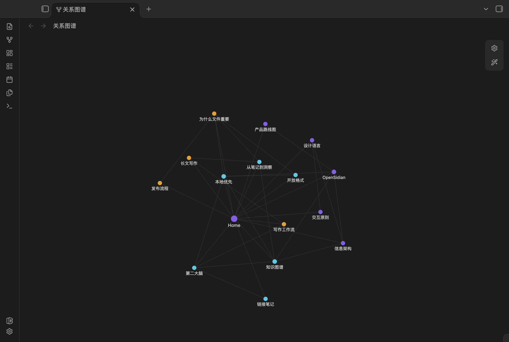

<div align="center">
  
  <h1 style="border-bottom: none; margin-bottom: 12px;">OpenSidian</h1>
  <p><strong>把笔记、白板、数据库与知识图谱，放回你自己的磁盘。</strong></p>
  <p>本地优先的开源 Markdown 知识工作台。直接打开 Obsidian 库，无需登录。</p>
  <p>
    <a href="https://github.com/huxi7/opencidian/releases/latest"></a>
    <a href="LICENSE"></a>
  </p>
  <p>
    <strong>下载</strong><br>
    <a href="https://github.com/huxi7/opencidian/releases/latest/download/opensidian-macos-arm64.dmg">macOS Apple Silicon</a>
    &nbsp;·&nbsp;
    <a href="https://github.com/huxi7/opencidian/releases/latest/download/opensidian-windows-x64.exe">Windows x64</a>
    &nbsp;·&nbsp;
    <a href="https://github.com/huxi7/opencidian/releases/latest/download/opensidian-linux-x64.AppImage">Linux x64</a>
    &nbsp;·&nbsp;
    <a href="https://github.com/huxi7/opencidian/releases">全部版本</a>
  </p>
</div>

<p align="center">
  <a href="https://github.com/huxi7/opencidian/releases/latest">
    
  </a>
</p>

## 为什么是 OpenSidian

- **文件属于你。** 笔记是 Markdown，白板与数据库是可迁移的普通文件。没有专有数据库，也没有格式锁定。
- **不只是一个编辑器。** 写作、画布、数据库与关系图谱共享同一批笔记、链接和属性。
- **为长期使用而设计。** 无账户、无订阅、无强制同步。文件始终在你的控制之下。

## 核心能力

- **Markdown**：实时预览、源码与阅读模式，支持代码高亮、数学公式和 Mermaid。
- **知识连接**：内部链接、反向链接、大纲、全文搜索与关系图谱。
- **Canvas**：在无边界画布中组合笔记、文字、媒体、链接与分组，并导出图片。
- **Bases**：用表格、列表、卡片与看板浏览笔记，支持筛选、排序、公式和 CSV。
- **工作区**：标签页、分栏、独立文档窗口、布局恢复、明暗主题与 CSS 片段。
- **效率工具**：命令面板、每日笔记、模板、书签与文件恢复。

## 一个库，四种工作方式

<p align="center">
  <a href="assets/readme/canvas.png"></a>
  &nbsp;
  <a href="assets/readme/bases.png"></a>
</p>

<p align="center">
  <sub><strong>Canvas</strong> · 把想法、笔记与素材放进同一张画布。&nbsp;&nbsp; <strong>Bases</strong> · 用看板、表格与卡片重组同一批笔记。</sub>
</p>

<p align="center">
  <a href="assets/readme/graph.png">
    
  </a>
  <br>
  <sub><strong>Graph</strong> · 让笔记、标签与附件之间的关系显形。</sub>
</p>

## 快速开始

下载安装包并启动，然后选择已有文件夹或新建库。

## 参与开发

需要 Node.js 22.18 或更新版本。

```sh
git clone https://github.com/huxi7/opencidian.git
cd opencidian
npm ci
npm start
```

技术栈为 TypeScript、Electron 与 CodeMirror 6。架构与模块边界见 [CLAUDE.md](CLAUDE.md)，发布流程见 [scripts/RELEASING.md](scripts/RELEASING.md)。

## 许可证

[AGPL-3.0](LICENSE)

OpenSidian 是独立开源项目，与 Obsidian 及其开发商无关联。「Obsidian」商标归其权利人所有。
